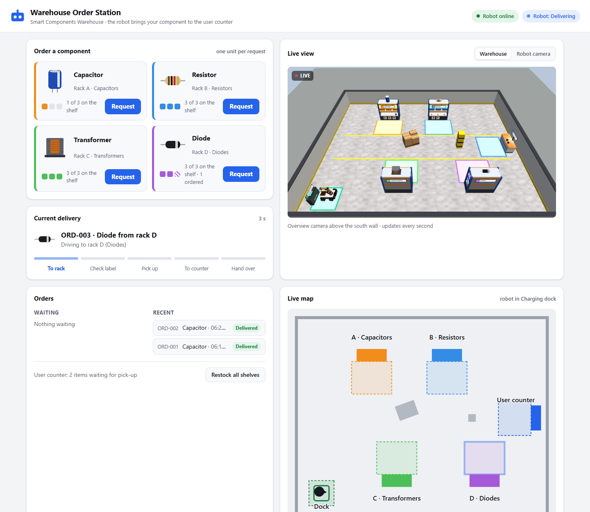
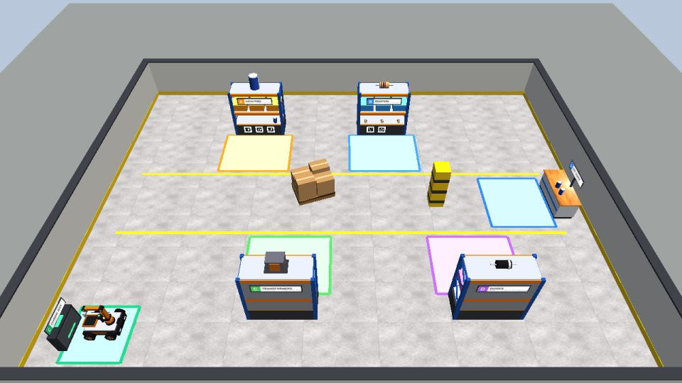

# Warehouse Inventory Robot (ROS 2 Humble · Gazebo · Nav2 · ros2_control)

The robot is a **warehouse rover**, a mobile manipulator built for this project:

- **Base:** a 4-wheel skid-steer rover with a 360° LiDAR on a mast and a front camera.
- **Arm:** 4 joints (turret, shoulder, elbow, wrist) with a two-finger **gripper**.
- **Cargo tray:** on the rear deck.

It works in a simulated electronic-components warehouse with four pallet racks:

| Rack | Product | Shelf stock |
|---|---|---|
| A | Capacitors | 3 units |
| B | Resistors | 3 units |
| C | Transformers | 3 units |
| D | Diodes | 3 units |

**Retrieval mode (default).** A user selects a component (for example, a diode) on the **order web page**. The rover then:

1. Drives to that rack with Nav2.
2. Checks the rack's bin labels with its camera.
3. Creeps in close to the shelf.
4. Reaches in with the arm, grips one unit and puts it in its cargo tray.
5. Drives to the **user counter**, where the arm sets the part down.

Orders queue up while the robot is busy, stock is tracked per shelf, and the rover returns to its charging dock when there is nothing left to do. The order page also shows a **live 3D view** of the warehouse and what the robot's camera sees.



*The order page during a diode order. Shelf stock is shown on each card, the step bar tracks the delivery, and the live view and map follow the rover.*



*The warehouse in Gazebo, from the overview camera. Racks A and B are at the back and C and D at the front. The user counter is on the right, and the rover is on its charging dock at bottom left.*

**Quick start** (Ubuntu 22.04 + ROS 2 Humble, after the setup in section 3):

```bash
ros2 launch warehouse_bot bringup.launch.py      # Gazebo + RViz + Nav2 + robot nodes + order page
# open http://localhost:8088 and press "Request" on any component
```

**Audit mode.** The original inventory audit is still available. The robot visits every rack, reads the ArUco tag on every stock bin and reconciles what it saw against the stock records. It then carries misplaced or unregistered items to the user counter. The warehouse is seeded with problems so the audit has something to find:

| Rack | Bin labels | What the audit should report |
|---|---|---|
| A · Capacitors | tags 0, 1, 2 | all OK (green) |
| B · Resistors | tags 3, 4 (tag 5 missing) | MISSING (red) |
| C · Transformers | tags 6, 7 + tag 11 (a Zener diode) from rack D | MISPLACED (orange) |
| D · Diodes | tags 9, 10 + unregistered tag 20 | UNKNOWN tag, tag 11 elsewhere (orange) |

Both modes write JSON result files (navigation accuracy, delivery times, tag detection) for the report.

## 1. What is in the package

```
warehouse_interfaces/            custom interfaces (ament_cmake)
  msg/OrderRecord.msg            one customer order and its delivery step
  msg/FetchStatus.msg            robot state + current order, queue, history
  msg/ProductStock.msg           units of one product on its shelf
  msg/StockReport.msg            shelf stock for every product
  msg/ZoneStatus.msg             which zone the robot is in + ENTER/EXIT events
  msg/InventoryItem.msg          one stock item and its audit status
  msg/InventoryReport.msg        per-zone and whole-warehouse reconciliation
  msg/ScanResult.msg             raw result of one zone scan
  srv/RequestItem.srv            "bring me a diode"
  srv/PickItem.srv               "take one unit off rack D" (simulated gripper)
  srv/ScanZone.srv               "scan the rack in front of you"

warehouse_bot/                   nodes, robot, world, map, web page, launch files (ament_python)
  config/warehouse_layout.yaml   SINGLE SOURCE OF TRUTH: racks, products, tags, zones, catalogue
  config/nav2_params.yaml        Nav2 tuned for the rover (rectangular footprint) and this warehouse
  config/rover_controllers.yaml  ros2_control: joint_state_broadcaster, arm_controller, gripper_controller
  warehouse_bot/
    rover_description.py         THE ROBOT: one description -> URDF (TF, RViz, ros2_control) + SDF (Gazebo)
    arm_kinematics.py            arm geometry + closed-form inverse kinematics (unit tested)
    fetch_manager.py             retrieval mode: order queue + delivery sequence with Nav2
    item_handler.py              arm + gripper pick/place sequences, shelf stock
    web_server.py                order web page + JSON API, bridges to ROS
    web_stdio_proxy.py           helper for the Windows relay (see 4.3)
    fetch_logic.py               pure-Python order book (unit tested)
    zone_detector.py             TF pose -> zone, publishes ZoneStatus
    marker_scanner.py            ArUco camera scanner (+ simulated RFID fallback), ScanZone service
    inventory_manager.py         audit reconciliation, InventoryReport, RViz zone colours
    mission_manager.py           audit mission using nav2_simple_commander
    layout.py                    layout model shared by everything
    inventory_logic.py           pure-Python audit rules (unit tested)
    vision.py                    image conversion + OpenCV-version-safe ArUco reader
    generate_world.py            builds world, map, textures, component and tag models from the layout
  web/index.html                 the order page (no internet needed)
  worlds/warehouse.world         generated Gazebo world
  maps/warehouse_map.{pgm,yaml}  generated ground-truth map
  models/aruco_marker_*/         generated tag models; models/warehouse_textures/ (floor, signs)
  launch/                        world, navigation, inventory, fetch, mission, bringup, slam
  rviz/warehouse.rviz
  test/test_arm.py, test/test_retrieval.py, test/test_inventory_logic.py

docs/                            screenshots used in this README
tools/web_relay_windows.py       order page relay for the development laptop (see 4.3)
run_warehouse.bat                one-click start on the development laptop (see 4.3)
```

## 2. Architecture (retrieval mode)

```
  Browser: order page  --HTTP-->  web_server --RequestItem srv--> fetch_manager --goals--> Nav2 --/cmd_vel--+
  (http://localhost:8088)          ^  ^  ^                         |  |   |   \_____ creep in/out ____/   |
                                   |  |  |  /warehouse/fetch_status|  |   | ScanZone                      v
                                   |  |  +-------------------------+  |   v                    Gazebo: warehouse rover
                                   |  |     /warehouse/stock          | marker_scanner         (diff drive, LiDAR,
                                   |  +------------------------- item_handler <--PickItem--+    camera, ros2_control)
                                   |                                  |  FollowJointTrajectory      ^
                                   |  live views (overview +          +--> arm_controller ----------+
                                   +--- robot camera images)          +--> gripper_controller ------+
                                                                      +--/gazebo/set_entity_state (grasp)
  zone_detector --/warehouse/current_zone--> fetch_manager, web_server (robot pose on the live map)
```

Each order goes through these steps:

1. **TO_RACK.** Nav2 drives to the rack's approach pose, 0.8 m from the shelf.
2. **CONFIRMING.** The camera must see at least one bin label that belongs to this rack. If it doesn't, the rover does one retry with a ±0.35 rad sweep, and fails the order rather than pick from the wrong rack.
3. **PICKING.** The rover squares up and creeps in to 0.5 m from the shelf, on `/cmd_vel` with odometry. Then the arm:
   1. opens the gripper;
   2. reaches over the nearest unit and lowers onto it;
   3. closes the fingers;
   4. lifts and backs out of the shelf;
   5. swings round and sets the part in the cargo tray.

   Then the rover backs out.
4. **TO_USER.** Nav2 drives to the user counter, with the part riding in the tray.
5. **HANDING_OVER.** The rover creeps in. The arm takes the part from the tray, swings forward and sets it on a free spot on the counter.
6. **DELIVERED.**

Stock is reserved when an order is accepted, so two users can't both get the last unit. After 8 s without orders the rover drives back to its charging station, and a new order interrupts that.

**How the arm is controlled.**

- **Joint angles:** `arm_kinematics.py` solves them in closed form, keeping the gripper level, from the rover's true pose in Gazebo.
- **Motion:** `ros2_control` runs them through JointTrajectoryControllers (`arm_controller`, `gripper_controller`).
- **Reach:** the layout loader refuses any shelf unit or counter spot the arm can't reach. The counter has 8 reachable delivery spots.
- **Grasp:** Gazebo Classic can't hold a part reliably by finger friction. So while the fingers are closed, `item_handler` attaches the part to the wrist link through `/gazebo/set_entity_state`; once released in the tray, it attaches the part to the rover. This is the usual way to simulate pick-and-place.

The components are real Gazebo models (kinematic, no collision) generated from the layout file.

## 3. Setup (Ubuntu 22.04 + ROS 2 Humble)

You need Ubuntu 22.04 (a normal install, or WSL2 on Windows 11), ROS 2 Humble Desktop and Gazebo Classic 11. Plan on at least 8 GB of RAM; a GPU makes Gazebo much smoother.

**3.1 Install dependencies** (ROS 2 Humble Desktop already installed):

```bash
sudo apt update
sudo apt install -y \
  ros-humble-gazebo-ros-pkgs ros-humble-navigation2 ros-humble-nav2-bringup \
  ros-humble-nav2-simple-commander ros-humble-slam-toolbox \
  ros-humble-gazebo-ros2-control ros-humble-ros2-controllers ros-humble-ros2-control \
  ros-humble-teleop-twist-keyboard \
  python3-opencv python3-yaml python3-colcon-common-extensions python3-rosdep python3-pytest unzip
```

**3.2 Create the workspace and copy the code:**

```bash
mkdir -p ~/warehouse_ws/src
cd ~/warehouse_ws/src
unzip ~/Downloads/warehouse_inventory_robot.zip     # gives warehouse_inventory_robot/
```

**3.3 Build:**

```bash
cd ~/warehouse_ws
source /opt/ros/humble/setup.bash
rosdep install --from-paths src --ignore-src -y     # skip if rosdep is not initialised
colcon build --symlink-install
```

**3.4 Environment** (add these to `~/.bashrc` so every terminal has them):

```bash
source /opt/ros/humble/setup.bash
source /usr/share/gazebo/setup.sh
source ~/warehouse_ws/install/setup.bash
```

**3.5 Optional sanity check:**

```bash
cd ~/warehouse_ws && colcon test --packages-select warehouse_bot && colcon test-result --verbose
ros2 interface show warehouse_interfaces/msg/FetchStatus
```

## 4. Running

### 4.1 Retrieval mode: order components from the web page

```bash
ros2 launch warehouse_bot bringup.launch.py
```

This starts Gazebo, RViz, Nav2, the inventory nodes, `fetch_manager`, `item_handler` and `web_server`. Open **http://localhost:8088** in a browser. The page shows:

- **Order a component.** One card per product with its shelf stock. **Request** orders one unit.
- **Current delivery.** The order being worked on, with a step bar: To rack → Check label → Pick up → To counter → Hand over.
- **Live view.** A 3D view of the warehouse from the overview camera, and a **Robot camera** tab showing what the rover sees. The robot camera shows the arm reaching into the shelf.
- **Live map.** Racks, the user counter, the dock and the robot's live position and trail. The current target pulses, and a coloured square on the robot means it is carrying a component.
- **Orders.** The waiting queue and recent orders, with delivery times and any failure reason.
- **Restock all shelves.** Puts every component back on its rack.

You can also order without the page:

```bash
ros2 service call /warehouse/request_item warehouse_interfaces/srv/RequestItem "{product: diode}"
ros2 topic echo /warehouse/fetch_status
ros2 service call /warehouse/restock std_srvs/srv/Trigger
```

`product` accepts `capacitor`, `Resistors`, `transformer`, `diode`, a rack id (`D`) or a rack name.

Useful launch arguments: `web_port:=9000`, `web_host:=127.0.0.1`, `rviz:=false`, `gui:=false`. The Gazebo window and RViz together slow the simulation down noticeably (see section 9). For quicker deliveries, launch with `rviz:=false`. With `gui:=false`, everything runs headless and you watch it on the order page's live view. For step-by-step runs, start `world`, `navigation` and `inventory` as in 4.2, then `ros2 launch warehouse_bot fetch.launch.py`.

### 4.2 Audit mode

```bash
ros2 launch warehouse_bot bringup.launch.py mode:=audit start_mission:=true
```

The audit begins after 25 s. On a slow PC, raise the delay with `mission_delay:=40.0`. To go step by step (better for debugging and the demo video):

```bash
# Terminal 1 - simulation
ros2 launch warehouse_bot world.launch.py
# Terminal 2 - Nav2 + RViz (robot is localised on the dock automatically)
ros2 launch warehouse_bot navigation.launch.py
# Terminal 3 - inventory nodes
ros2 launch warehouse_bot inventory.launch.py
# Terminal 4 - wait until RViz shows the robot on the map, then:
ros2 launch warehouse_bot mission.launch.py
```

To run the audit again without restarting, either let it finish (it ends on the dock) or pass `set_initial_pose:=false` if the robot is somewhere else.

### 4.3 On Windows (WSL2)

**Any Windows 11 PC with WSL2.** Install Ubuntu 22.04 in WSL and follow sections 3 and 4.1 inside it. Gazebo and RViz open as normal windows through WSLg. WSL forwards `localhost`, so the order page opens at **http://localhost:8088** in a Windows browser.

**The development laptop.** Here a firewall blocks network traffic between Windows and WSL, so the setup above can't reach the order page. Instead, double-click **`run_warehouse.bat`**. It:

- syncs this folder into WSL (`~/warehouse_ws`) and rebuilds;
- starts everything in retrieval mode;
- opens the order page at **http://localhost:8088**.

For audit mode, run `run_warehouse.bat mode:=audit`.

The `.bat` calls a helper script, `~/run_warehouse.sh`, that exists only inside that laptop's WSL. On any other PC, use the steps above.

How the order page gets through the firewall: `tools/web_relay_windows.py` listens on `127.0.0.1:8088` on Windows. It passes each request through the stdin/stdout pipes of a `wsl.exe` child process (`web_stdio_proxy`) to `web_server`, which listens on `127.0.0.2:8089` inside WSL. The `.bat` starts and stops the relay for you.

### 4.4 What you should see

- **Gazebo.** The rover drives to the rack and creeps in. The arm unfolds, reaches into the bottom shelf, grips a component, lifts it out and sets it in the cargo tray. The rover drives to the user counter, where the arm lifts the part out of the tray and places it on the wooden counter top. The arm then folds back into its stowed "crane" pose.
- **Order page.** The step bar advances, stock goes down, and the order moves to *Recent* as *Delivered*.
- **RViz.** The planned path and the LiDAR scan. Zone colours update whenever a rack is scanned (in both modes).
- **Terminal.** `[ORD-001] TO_RACK ... CONFIRMING ... camera check: saw rack D labels [9, 10] ... PICKING ... DELIVERED`.
- **Results.** `~/warehouse_results/fetch_*.json` has per-order step results, nav errors, camera checks, delivery time and a summary. The audit writes `mission_*.json` and `inventory_*.json`.

## 5. Testing individual parts

```bash
# Which zone is the robot in?
ros2 topic echo /warehouse/current_zone
ros2 topic echo /warehouse/zone_events

# Arm controllers (all three should be "active")
ros2 control list_controllers
# Move the arm by hand: reach forward, then back to the stowed pose
ros2 action send_goal /arm_controller/follow_joint_trajectory control_msgs/action/FollowJointTrajectory \
  "{trajectory: {joint_names: [arm_turret, arm_shoulder, arm_elbow, arm_wrist],
    points: [{positions: [0.0, -1.09, 1.79, -0.70], time_from_start: {sec: 3}}]}}"
ros2 action send_goal /arm_controller/follow_joint_trajectory control_msgs/action/FollowJointTrajectory \
  "{trajectory: {joint_names: [arm_turret, arm_shoulder, arm_elbow, arm_wrist],
    points: [{positions: [0.0, -1.5708, -1.5708, -1.5708], time_from_start: {sec: 3}}]}}"

# Shelf stock and a pick / place by hand (park the rover in front of a rack / the counter first)
ros2 topic echo /warehouse/stock
ros2 service call /warehouse/pick_item warehouse_interfaces/srv/PickItem "{rack_id: 'D'}"
ros2 service call /warehouse/place_item std_srvs/srv/Trigger

# Drive manually with RViz "2D Goal Pose", or the keyboard:
ros2 run teleop_twist_keyboard teleop_twist_keyboard

# Print the robot description
python3 -m warehouse_bot.rover_description --urdf     # or --sdf

# Scan whatever rack the robot is facing:
ros2 service call /inventory/scan_zone warehouse_interfaces/srv/ScanZone "{zone_id: 'A', duration: 4.0}"

# Reconciliation output (audit)
ros2 topic echo /inventory/report

# Dynamic obstacle test: drop a crate in the aisle while the robot is driving
ros2 run gazebo_ros spawn_entity.py -entity crate1 -x 0.5 -y -0.6 \
  -file $(ros2 pkg prefix warehouse_bot)/share/warehouse_bot/models/warehouse_crate/model.sdf

# Camera unavailable or slow? Use the simulated RFID reader instead:
ros2 launch warehouse_bot bringup.launch.py scan_mode:=rfid_sim

# Unit tests without ROS (arm kinematics, robot files, layout, order book, audit rules):
cd warehouse_bot && python3 -m pytest test/
```

## 6. Changing the warehouse

Edit `warehouse_bot/config/warehouse_layout.yaml`. You can change the product on a rack (`product: {id, name, units, shape}`, with shape `capacitor | resistor | transformer | diode | box`), move or add racks, put different tags in the slots, or change the catalogue, the retrieval settings (`fetch:`) or the audit order (`mission:`). Then regenerate and rebuild:

```bash
ros2 run warehouse_bot generate_world --package-dir ~/warehouse_ws/src/warehouse_inventory_robot/warehouse_bot
cd ~/warehouse_ws && colcon build --symlink-install
```

The world, map, zones, scan poses, component models, signs and counter spots are all regenerated from the same geometry, so they always agree. The layout loader refuses overlapping zones, duplicate products, unknown shapes, catalogue entries that point at missing racks, and any shelf unit the arm can't reach. If you move the dock, also update `amcl.initial_pose` in `config/nav2_params.yaml`.

To change the robot, edit `warehouse_bot/rover_description.py` (body, wheels, sensors, arm visuals) and `warehouse_bot/arm_kinematics.py` (arm lengths, joint limits, stowed pose, tray position). Both robot files (URDF and SDF) are built from these at launch. `test/test_arm.py` checks that they agree.

**Optional: build the map with SLAM** (useful for the report's map-design section):

```bash
ros2 launch warehouse_bot world.launch.py
ros2 launch warehouse_bot slam.launch.py
ros2 run teleop_twist_keyboard teleop_twist_keyboard
ros2 run nav2_map_server map_saver_cli -f ~/warehouse_slam_map
ros2 launch warehouse_bot navigation.launch.py map:=$HOME/warehouse_slam_map.yaml
```

## 7. Interface reference

| Name | Type | Direction |
|---|---|---|
| `/warehouse/request_item` | `warehouse_interfaces/srv/RequestItem` | web_server / CLI → fetch_manager |
| `/warehouse/fetch_status` | `warehouse_interfaces/FetchStatus` | fetch_manager → web_server |
| `/warehouse/pick_item` | `warehouse_interfaces/srv/PickItem` | fetch_manager → item_handler |
| `/warehouse/place_item` | `std_srvs/srv/Trigger` | fetch_manager → item_handler |
| `/warehouse/restock` | `std_srvs/srv/Trigger` | web_server / CLI → item_handler |
| `/warehouse/stock` | `warehouse_interfaces/StockReport` | item_handler → fetch_manager, web_server (latched) |
| `/arm_controller/follow_joint_trajectory` | `control_msgs/action/FollowJointTrajectory` | item_handler → ros2_control (arm) |
| `/gripper_controller/follow_joint_trajectory` | `control_msgs/action/FollowJointTrajectory` | item_handler → ros2_control (fingers) |
| `/joint_states` | `sensor_msgs/JointState` | joint_state_broadcaster + wheel plugin → robot_state_publisher, item_handler |
| `/gazebo/set_entity_state`, `/gazebo/get_entity_state` | `gazebo_msgs/srv/...` | item_handler → Gazebo (grasp attachment, rover pose) |
| `/cmd_vel`, `/odom`, `/scan` | `geometry_msgs/Twist`, `nav_msgs/Odometry`, `sensor_msgs/LaserScan` | Nav2 / fetch_manager (creep) ↔ rover |
| `/camera/image_raw` | `sensor_msgs/Image` | rover front camera → marker_scanner, web_server |
| `/warehouse/overview/image_raw` | `sensor_msgs/Image` | overview camera → web_server (live view) |
| `/warehouse/current_zone` | `warehouse_interfaces/ZoneStatus` | zone_detector → all |
| `/warehouse/zone_events` | `warehouse_interfaces/ZoneStatus` | zone_detector → (transient local) |
| `/inventory/scan_zone` | `warehouse_interfaces/srv/ScanZone` | fetch_manager, mission_manager → marker_scanner |
| `/inventory/scan_results` | `warehouse_interfaces/ScanResult` | marker_scanner → inventory_manager |
| `/inventory/report` | `warehouse_interfaces/InventoryReport` | inventory_manager → mission_manager |
| `/inventory/zone_markers` | `visualization_msgs/MarkerArray` | inventory_manager → RViz |
| `/inventory/debug_image` | `sensor_msgs/Image` | marker_scanner → RViz |
| `/warehouse/events` | `std_msgs/String` (JSON) | fetch_manager, mission_manager → inventory_manager |

Useful parameters:

- **fetch_manager:** `confirm_with_camera`, `require_confirmation`, `confirm_duration`, `return_to_dock_when_idle`, `idle_return_delay`, `max_queue`, `nav_timeout`, `set_initial_pose`.
- **item_handler:** `robot_entity` (default `rover`), `arm_speed` (rad/s), `carry_rate`.
- **layout `fetch:`:** `pick_standoff` and `counter_standoff`, the distance between the robot centre and the shelf or counter while the arm works.
- **web_server:** `host`, `port`, `web_dir`.
- **marker_scanner:** `scan_mode`, `image_topic`, `min_detections` (default 2 frames), `max_process_rate`, `fallback_to_rfid`, `rfid_range`.
- **mission_manager:** `zone_order`, `scan_duration`, `sweep_angle`, `relocate_flagged`, `return_to_dock`, `set_initial_pose`.

## 8. Troubleshooting

| Symptom | Fix |
|---|---|
| Gazebo hangs on a black screen the first time | First start can take a minute. Run `killall gzserver gzclient` and relaunch. In a VM, try `export LIBGL_ALWAYS_SOFTWARE=1`. |
| Robot missing in Gazebo, or the arm doesn't move | Look for `Spawn status: ... spawned entity [rover]` and `Configured and activated arm_controller` in the launch output. Run `ros2 control list_controllers`. If the controllers are missing, install `ros-humble-gazebo-ros2-control` and `ros-humble-ros2-controllers`. |
| Pick fails with "No unit ... within the arm's reach" | The rover stopped too far from the shelf, usually because of localisation. Check the `approach` entry in `fetch_*.json`, and the LiDAR overlay in RViz. |
| `libcurl ... fuel.ignitionrobotics.org ... timed out` in the log | Gazebo's Insert-tab model browser can't reach the internet (firewall). The lookup gives up after about 3.5 min. It comes from the GUI (gzclient); the simulation itself (gzserver) is not affected. `world.launch.py` already disables the classic model database. |
| Tags appear as grey squares | Gazebo can't find the models. Rebuild, then run `source install/setup.bash`. Check `ls $(ros2 pkg prefix warehouse_bot)/share/warehouse_bot/models`. |
| Order page says "Robot software starting" | `fetch_manager` waits for Nav2. Orders placed now are queued and start once Nav2 is active. |
| Order page doesn't load | Check the terminal for `Order page: http://...`. On the WSL laptop, start through `run_warehouse.bat` so the relay runs. If the port is taken, use `web_port:=<free port>`. |
| Order fails with "Camera check failed" | The robot couldn't see any label of that rack. Watch the "Scanner Camera" panel in RViz. If needed, use `confirm_with_camera:=false` (fetch.launch.py) or `require_confirmation: false` in the layout file. |
| Component stays on the shelf although the arm moved | `item_handler` needs the `gazebo_ros_state` world plugin. Regenerate the world (section 6) and check that `ros2 service list` shows `/gazebo/set_entity_state`. |
| Scanner says "no camera frames" | Run `ros2 topic list \| grep image`. If the topic name differs, use `image_topic:=<name>`. The scanner falls back to simulated RFID automatically. |
| Robot shown in the wrong place in RViz | Use "2D Pose Estimate" on the dock (bottom-left green pad in front of the charging station, facing east). |
| Waits forever on "Waiting for Nav2" | Check the navigation terminal for errors. All Nav2 lifecycle nodes must reach *active*. |
| Goal fails near a rack | The goal is at least 0.8 m from the rack, so this is usually localisation. Watch the LiDAR overlay in RViz to confirm it matches the map. |
| Deliveries are slow, or the log says `Behavior Tree tick rate ... was exceeded` | The PC can't run Gazebo's GUI, RViz and the simulation at full speed. Launch with `rviz:=false`, or `gui:=false` and watch on the order page's live view. |
| `rviz2 ... process has died [exit code -11]` when you stop everything | Harmless. RViz crashes during shutdown once the nodes it was showing have gone. |

## 9. Measured results

These are deliveries made with the rover. The numbers come from `~/warehouse_results/fetch_*.json`.

| Run | Component | Result | Delivery time | Nav2 to rack: position / heading error | Nav2 to counter: position / heading error | Camera check before the pick |
|---|---|---|---|---|---|---|
| Headless (`gui:=false rviz:=false`) | Diode (rack D) | Delivered | 164 s | 0.047 m / 4.4° | 0.116 m / 4.4° | saw rack D label 10 |
| Gazebo GUI + RViz | Capacitor (rack A) | Delivered | 360 s | 0.086 m / 4.5° | 0.073 m / 4.0° | saw rack A labels 0, 1, 2 |
| Gazebo GUI + RViz | Capacitor (rack A) | Delivered | 228 s | 0.044 m / 5.7° | 0.060 m / 4.5° | saw rack A labels 1, 2 |
| Gazebo GUI + RViz | Diode (rack D) | Delivered | 319 s | 0.119 m / 4.5° | 0.055 m / 4.4° | saw rack D label 10 |

- **Delivery success:** 4 orders, all delivered. Nav2 reached every rack and counter goal (100% navigation success).
- **Positioning:**
  - Nav2 stops within 0.04–0.12 m and 4–6° of each goal.
  - The odometry-based creep to the shelf and the counter then usually lands within 5 mm of its target distance. The worst case was 6 cm, in the slow GUI run, and the arm still reached the part.
- **Camera:** every pick was preceded by a successful camera check of the rack's bin labels.
- **Speed:** a delivery takes about 2.5 minutes headless. With the Gazebo window and RViz open on the same PC it took about 4–6 minutes, because the simulation ran slower than real time.
- **Unit tests:** 35 passed (`python3 -m pytest test/`). They cover the arm kinematics, the agreement between the URDF and SDF, the layout and reach checks, the order book and the audit rules.

**Known limitations**

- **Simulated grasp.** Gazebo Classic can't hold small parts by finger friction. While the fingers are closed, the part is attached to the wrist (section 2), and the components have no collision geometry.
- **No arm motion planning.** Arm moves use closed-form inverse kinematics, not MoveIt, so the arm doesn't check for collisions. Instead, the approach and lift waypoints are chosen so that it clears the shelf.
- **Startup time.** Gazebo with the GUI can take a minute or more to start, and the order page shows "Robot software starting" until Nav2 is active.

## 10. How this maps to the evaluation criteria

- **Functionality (40%).** A user selects a component on an external interface (web page, or the ROS service). The mobile manipulator drives to the right rack, picks the part with its arm and gripper, and delivers it to the user counter. Path planning and obstacle avoidance use Nav2, routing around the static pallet and pillar and around crates spawned at runtime. Orders queue up, stock is tracked, and the robot returns to the dock when idle. Zone recognition works two independent ways: a geometric zone detector, plus camera reading of the rack labels before every pick.
- **Creativity (30%).** The custom 4-wheel rover has a 4-joint arm, a gripper and a cargo tray, and does visible pick-and-place: shelf → tray → counter. The order page has a live 3D view, a robot-camera view, a live map and delivery progress. The warehouse has pallet racking, printed signs, a textured floor and lighting. Stock is reserved per order. The robot reads real fiducial tags with its camera. The audit mode reconciles against stock records. A single YAML file generates the world, map, zones, products and counter.
- **Technical accuracy (20%).** The project uses:
  - one robot description emitting both URDF and SDF;
  - `ros2_control` (gazebo_ros2_control, JointTrajectoryControllers, joint_state_broadcaster) and closed-form inverse kinematics with reachability checks;
  - FollowJointTrajectory action clients;
  - custom msgs and srvs (8 msgs, 3 srvs), publishers and subscribers, latched topics, services with multi-threaded executors and callback groups;
  - Gazebo entity-state services, TF2 lookups;
  - Nav2 via the simple commander (including cancelling a goal when a new order arrives), plus odometry-based fine approach;
  - ROS parameters, launch composition with modes;
  - unit tests for the kinematics, robot files, layout, order book and audit rules.
- **Documentation (10%).** This README with screenshots and measured results, launch files for every stage, JSON results for the report, and a demo flow for the video.

## 11. Recording the demo video (5–10 min)

1. Open with Gazebo: the rover on its charging dock (orbit the camera around it: wheels, LiDAR, camera, arm, tray), the four signed racks (Capacitors, Resistors, Transformers, Diodes) with components on the bottom shelves, and the user counter.
2. Show the order page: product cards with stock, the live view, the live map and the empty queue.
3. Order a **capacitor** (rack A faces the overview camera, so the whole pick is in view). Follow the steps: path planning, the zone ENTER message, the camera check (Scanner Camera panel in RViz), the creep in, and the arm picking the part into the tray (switch the live view to **Robot camera** too). Then the drive to the counter and the arm placing the part.
4. While the robot is driving, order a capacitor and a resistor to show the queue. Spawn a crate in the aisle to show replanning.
5. Order until a shelf is empty to show "Out of stock", then **Restock all shelves**.
6. Optional: run `mode:=audit` to show the inventory audit and the reconciliation colours in RViz.
7. Finish with `~/warehouse_results/fetch_*.json`: delivery times, navigation accuracy and camera checks.
